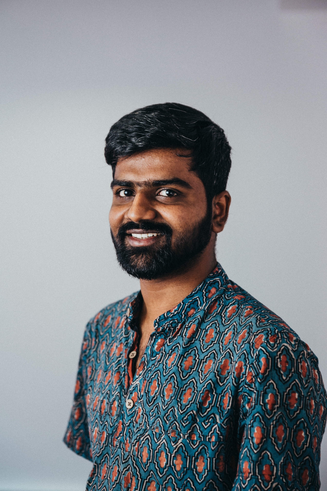

<section id="about" class="hero">
  

    
    <ul class="contact">
      <li><i class="fa-regular fa-envelope"></i><a href="mailto:balasai.vanukuri@psemail.eu">balasai.vanukuri@psemail.eu</a></li>
      <li><i class="fa-regular fa-file-lines"></i><a href="/files/Balasai_CV.pdf">CV</a></li>
      <li><i class="fa-brands fa-linkedin"></i><a href="https://www.linkedin.com/in/balasai-vanukuri/">LinkedIn</a></li>
      <li><i class="fa-brands fa-github"></i><a href="https://github.com/balasai-vanukuri">GitHub</a></li>
    </ul>
  

  

    <h1>Balasai Vanukuri</h1>
    
I am a PhD candidate in Economics at the <a href="https://www.parisschoolofeconomics.eu/">Paris School of Economics</a> (PSE) and <a href="https://www.pantheonsorbonne.fr/">Université Paris 1 Panthéon-Sorbonne</a>, where my research is advised by <a href="https://www.parisschoolofeconomics.eu/personnes/karen-macours/">Karen Macours</a> and <a href="https://www.parisschoolofeconomics.eu/personnes/oliver-vanden-eynde/">Oliver Vanden Eynde</a>. I was a Visiting Scholar at MIT in Fall 2025, hosted by <a href="https://www.econ.uzh.ch/en/people/faculty/banerjee.html">Abhijit Banerjee</a>. 

    
<strong>I am on the 2026–2027 academic job market.</strong>

   
My research is in development economics, at the intersection of political economy and human capital. I look at how social networks and identity shape economic opportunities and support for redistribution. I also study how people and communities cope with climate risks, and how skills and technology help them adapt.

    
 Currently, I am also a Research Consultant at the World Bank Development Research Group and an Associate Researcher at the Education Policy and Social Mobility Chair at PSE. Before my PhD, I was a Tobin Predoctoral Fellow at Yale University. I did a B.Tech. and M.Tech. in Chemical Engineering at IIT Delhi, before I turned to economics.

  

</section>

<section id="research">
  <h2>Research</h2>

  <h3>Job Market Paper</h3>
  

    
<a href="files/Balasai_Vanukuri_JMP.pdf" target="_blank" rel="noopener">Backlash or Bonding: Effect of an Integration Policy in the
Context of Affirmative Action </a>

    
<a href="#" data-target="abs-jmp">Abstract</a>

    
Do policies that promote cross-caste contact expand economic opportunities and increase support for affirmative action? I study this question by exploiting random assignment of first-year roommates at a highly selective public university in India, using original survey data on 2,267 students across two cohorts. A theoretical framework of social integration guides my analysis: students allocate scarce social time between within-group ties, which provide belonging and social support, and cross-group ties, which can expand economic opportunities. One year after assignment, lower-caste students in mixed-caste rooms have better grades but worse mental health than their caste peers in same-caste rooms, while upper-caste students' grades decline. 
Data on social interactions and help exchanges shed light on the mechanisms: lower-caste students gain academic help but lose social support, while upper-caste students lose same-caste academic collaborations. Consistent with these frictions, students are more likely to choose same-caste roommates when given the choice in the second year. Three years later, these costs extend to the labor market: upper-caste students receive 20\% lower internship stipends, while lower-caste students are less likely to receive a summer internship offer. Cross-caste contact initially increases both groups' support for affirmative action; by year three, however, mixing reduces upper-caste support for employment reservations. Overall, cross-caste contact narrows academic gaps but entails asymmetric economic and psychological costs, shaping subsequent social choices and attitudes toward affirmative action.

  <h3>Working Papers</h3>
  

<a href="files/Weathershocks_cooperation.pdf" target="_blank" rel="noopener">Impact of Weather Shocks on Trust in Agrarian Communities: Evidence from Rural India</a>

    
<a href="#" data-target="abs-weather">Abstract</a>

    
This paper examines how drought affects collective action in rural India. Using the two-wave
India Human Development Survey panel (2005 and 2012) and district-level drought measures (SPEI), I
compare households in districts within the same state that experienced different numbers of dry seasons.
Wet-season (Kharif) drought is not associated with reported community cooperation on water problems,
while dry-season (Rabi) drought increases cooperation by about three percentage points, which does not
differ significantly by baseline irrigation access. Ongoing work investigates the mechanisms 

  <h3>Work in Progress</h3>
  

    
Family Trees of Opportunity: Vertical Peer Effects and Skill Transmission in Public Universities

    
with Oscar Diaz and Palaash Bhargava

    
<a href="#" data-target="abs-trees">Abstract</a>Analysis ongoing

    
How do vertical ties to older mentors and horizontal ties to peers jointly shape students’ long-term economic opportunities? We study a mentoring program at a highly selective public engineering institution in India, where incoming students are randomly assigned an older-student mentor and placed in groups of five to six co-mentees. Combining administrative records spanning 17 cohorts and 14,599 students with LinkedIn profile data, we examine how caste and specialization matches with mentors affect labor-market outcomes, and whether mentor ties complement or substitute for peer ties. The setting also allows us to map networks beyond direct ties, tracing connections through mentors’ own mentors and their other mentees to examine how indirect ties shape outcomes. The project is in the final stages of linking administrative records to LinkedIn profiles.

  

  

    
Enabling Access to Safe Water: Evidence from Gujarat

    
with Vrinda Sharma

    
<a href="#" data-target="abs-water">Abstract</a>Piloting completed

    
 In rural India, groundwater quality is threatened by seawater intrusion and chemical contamination, as bore wells and aquifers deepen. In partnership with an NGO in Gujarat, we are piloting interventions to improve the operation of reverse osmosis (RO) plants, which reduce salinity and remove chemical contaminants, and encourage households to use treated water. On the supply side, preliminary evidence from a pilot involving 14 plants suggests that operator training combined with financial incentives may help keep plants operational. On the demand side, we surveyed 140 households across seven randomly selected pilot villages, combining household surveys with administrative data on plant-level water consumption to measure uptake. All households in these villages received information on the health risks of unsafe water and vouchers for three months of free treated water, while a randomly selected half also received water-quality testing and individualized feedback. Preliminary comparisons suggest higher uptake in pilot than in non-pilot villages, with no detectable additional effect of testing and feedback. These early findings will inform a large randomized controlled trial on plant operations and household uptake. Because RO plants require reliable water and electricity, their locations are constrained by infrastructure availability, potentially limiting access for households in remote hamlets. We are piloting water kiosks to bring treated water closer to these communities and test whether reducing the distance households travel to collect water increases uptake.

      
  

  

    
Transfers, Income Diversification and Climate Adaptation: Long-term Evidence

    
with Karen Macours, Patrick Premand, and Renos Vakis

    
Analysis ongoing

  
  

  

    
Building Skills in Agri-Food Systems: A Meta-Analysis of Extension and Training Programs

    
with Karen Macours, Marcelo Gantier, and Amit Khanal

     
Analysis ongoing

  
    
  

  

    
Natural Disasters, Land Markets, and Inter-Religious Dynamics: Evidence from Bihar

    
with Oliver Vanden Eynde and Nitin Bharati

     
Analysis ongoing

  

<section id="teaching">
  <h2>Teaching</h2>
  
<strong>Econometrics 2A </strong>, Teaching Assistant, Analysis and Policy in Economics (APE), Paris School of Economics, 2026–27

  
<strong>Econometrics 2</strong>, Teaching Assistant, Master's in Economics, Université Paris 1 Panthéon-Sorbonne, 2026–27

  
<strong>Linear Algebra (undergraduate)</strong>, Teaching Assistant, Université Paris 1 Panthéon-Sorbonne, 2026–27

  
<strong>Econometrics 1 </strong>, Teaching Assistant, Master 1 in Public Policy and Development (PPD), Paris School of Economics, 2022–23 and 2023–24

</section>
